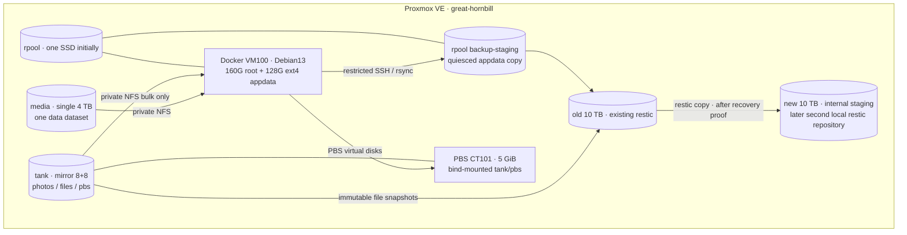

# Proxmox migration

[Repository overview](../README.md)

Sources: read-only Unraid audits on 2026-11-09 and 2026-11-10;
[current status](status.md), [PVE host](pve-host.md),
[Docker stacks](docker-stacks.md), [Proxmox backups](backups-proxmox.md),
[existing Unraid backups](backups-unraid.md).

This is desired configuration and a future cutover runbook. The running Unraid
host has not been reconfigured. Never deploy the PVE/Docker roles to Unraid.

## Scope and decision

Run Proxmox VE 9 on the existing box, with Docker Compose in one Debian 13 VM.
Keep ZFS on the host, guest-local databases, and independent file backups.
This improves recoverability and configuration ownership, not availability:
a single host failure still stops every local guest.

## Hardware audit

Historical 2026-11-09 measurements, retained separately from desired settings:

| Item | Observed |
| --- | --- |
| Platform | SANGFOR ABOS-1000-D600; SuperMicro X11SSL-WZ; BIOS 3.6 |
| CPU | Xeon E3-1245 v6, 4C/8T; VT-d active, 13 IOMMU groups |
| RAM | 31 GiB; 2×16 GiB DDR4-2400 non-ECC; two free slots |
| GPU | GTX 1650 4 GiB, group 1 with root port `00:01.0`; ASPEED host console |
| Network | Two Intel I210 1 GbE; active-backup bond with second link down |
| Expansion | Six SATA ports, five occupied; no onboard M.2 |
| UPS | ONLINE, 17% load, 53 minutes; USB product string said CP1500 AVR |
| IPMI | Available; 34 SEL entries; FAN1 700 RPM; CPU 48 °C, PCH 43 °C |

The 2026-11-10 audit found:

- Unraid 7.3.2; 46 days uptime; LAN `192.168.15.36/24`, gateway `192.168.15.1`.
- 33 Docker containers, 32 running; the created StirlingPDF container was stopped.
  Homelable images existed but no Homelable containers were running.
- Docker filesystem: 43/60 GiB used. Minecraft used about 7.6 GiB;
  Frigate about 1.5 GiB. These are idle observations, not peak sizing proof.
- GPU driver `595.104.02`; 389/4096 MiB VRAM used at the sample.
- Paperless image 2.20.15, PostgreSQL database with 86 documents;
  Immich server image v3.1.0, with zero active external libraries.
- Source application/initialization database passwords matched the vault for
  Paperless and order-manager. Earlier documentation claiming the order-manager
  passwords differed was incorrect.
- The collector private key matched `files/ssh/great-hornbill.pub`; its private
  half and existing host-key pins are now vaulted for migration.
- `/var/log` was full: roughly 60 MiB rotated syslog and 54 MiB nginx logs in a
  128 MiB tmpfs. No files were removed during the audit.
- SSD SMART passed, with no reallocated sectors or CRC errors; btrfs device error
  counters were zero, but there was no scrub history. HDD SMART queries used
  `-n standby`; sleeping disks did not yield fresh health attributes.
- UPS firmware reports **UT1050EG, 630 W nominal**, despite USB ID `0764:0501`
  advertising CP1500 AVR. It was ONLINE at 13% load with 60.5 minutes remaining.
  Existing apcupsd thresholds were 25% charge, 10 minutes remaining, and
  600 seconds maximum on battery. The old 900 W / ~150 W estimate is not a
  valid power measurement.
- `domains/haos-krm/haos.qcow2` still exists. Preserve it; a failed connection to
  the inactive libvirt service does not establish that the disk is disposable.
  The ISO share was empty.

## Storage layout before migration

Historical 2026-11-09 disk measurements; names below describe that audit only.
Use serials and `/dev/disk/by-id` for every destructive operation.

| Device | Model | Size | Role | Hours | Temperature |
| --- | --- | --- | --- | --- | --- |
| `sda` | SanDisk Ultra 3D | 1 TB | btrfs cache, single | 329 | 32 °C |
| `sdb` | HGST HUS726040ALA610 | 4 TB | XFS media | 2 103 | 33 °C |
| `sdc` | WD80EFZZ | 8 TB | array data | 4 370 | 29 °C |
| `sdd` | ST8000VN004 | 8 TB | parity | 13 769 | 28 °C |
| `sde` | Toshiba MG06ACA10TE | 10 TB | XFS restic target | 35 094 | 27 °C |
| `sdg` | ATP USB flash | 7.5 GB | Unraid boot | — | — |

The retained restic disk has serial `28W0A2QGFKQE`, filesystem UUID
`6d3f33cb-faaf-4497-8131-2f40f07cfbbd`. Do not initialize or reformat it.
New10 TB Toshiba MG06ACA10TE, serial `19L0A0EDFHLG`, by-id
`/dev/disk/by-id/ata-TOSHIBA_MG06ACA10TE_19L0A0EDFHLG`, was explicitly prepared
for the cold copy: full-size GPT/XFS, label `HLSTAGING`, filesystem UUID
`d0347cdb-9c3b-41e8-88ce-498367a6f038`, mounted at `/mnt/staging`. No LUKS.
The operator reported it tested and zeroed; those jobs were not repeated.
Only this new disk's old2 TB partition layout was replaced; source disks and the
old restic vault remain intact.

## Data inventory

| Tree | Original estimate | Preservation policy |
| --- | --- | --- |
| `photos` | ~2.05 TB | Irreplaceable; mirrored and backed up |
| `appdata` | 41 GB | Irreplaceable; local guest disk, PBS and restic |
| `data` | 679 GB | Replaceable media; no backup |
| `backup` | 60 GB | Stage all; restore the collector subtree, retain old plugin archives through recovery proof |
| `files`, `domains`, `isos` | 12 GB combined | Preserve files and legacy HAOS disk; do not infer disposability from inactivity |
| Existing restic repository | ~2 TB | Keep repository and historical snapshots intact |

Re-measure actual trees and staging free space before copying. Include sparse
VM disks with `rsync -S`; preserve hardlinks, ACLs, xattrs and numeric IDs.

## Target architecture



- **One Docker VM, not Docker-in-LXC.** GPU and Docker upgrades remain guest-owned.
- **Local databases.** `/mnt/appdata` is ext4 on serial `homelab-appdata`, not
  NFS. A host-backed virtual disk is guest-local storage; PostgreSQL/SQLite never
  use the host's exported filesystem.
- **Private storage network.** `vmbr1` has no physical ports: host
  `10.77.0.1/29`, Docker `10.77.0.2/29`, PBS `10.77.0.3/29`. No gateway on this NIC.
  The VM's LAN NIC can use DHCP; its storage endpoint cannot drift.
- **Management.** PVE retains a static LAN address/hostname for recovery, but SSH
  and port 8006 accept only loopback/Tailscale after IPMI and tailnet proof.
  Do not reverse-proxy PVE through Caddy in the application VM.
- **GPU.** Both GTX1650 functions go to VM100; ASPEED stays with the host. Do not
  introduce ACS override or a second iGPU driver stack for this migration.
- **VM firmware.** Use OVMF/UEFI with dedicated EFI variables. The actual
  SeaBIOS+GTX1650 boot stalled before disk reads, while the same disks booted
  without GPU and then with OVMF plus both functions. Debian supports both;
  this choice follows hardware evidence. Serial-only VNC is explicit display config.
- **Recovery tools.** PBS protects guest disks; restic independently protects
  files, consistent appdata, and recovery credentials. PBS can also back up host
  directories using its client; a remote-protection destination remains deferred.

## Storage decision: ZFS mirror

Keep `tank` as an 8+8 mirror, the 4 TB media disk separate, and both 10 TB disks
on backup duty. Eight TB decimal is about 7.28 TiB before pool overhead.
The mirror is not counted as two independent backups.

Two-disk RAIDZ1 is supported by the OpenZFS CLI (parity count plus one is the
minimum); installer restrictions differ. It offers a possible future RAIDZ
expansion path but is not chosen here. Do not change geometry merely to use
otherwise unnecessary primary capacity.

### Disk replacement and expansion

- Replace a mirror member with a device meeting the vdev's required size; check
  exact bytes, not only the retail capacity label. Both mirror members must grow
  before usable capacity grows. Two 18 TB members yield about 18 TB decimal,
  not 16 TB decimal.
- Another mirror vdev needs two ports; losing either whole vdev loses the pool.
  Attaching a third mirror member adds redundancy, not capacity.
- Mirror-to-RAIDZ conversion requires rebuilding elsewhere and copying data.
- OpenZFS 2.3 RAIDZ expansion adds one disk at a time to an existing RAIDZ vdev,
  not to a mirror. Parity level stays fixed; old block ratios affect accounting.
- Replacement rules are based on required vdev size, not universally on the
  failed disk's advertised size. Partitioning does not create an irrevocable
  capacity ceiling, although whole disks are easier to manage.
- Buy CMR drives; SMART `PASSED`, power-on hours and cycle counts alone are not
  a guarantee of future reliability. Complete long tests before destructive work.

### Spin-down

Keep ZFS and measure actual idle behaviour before adding mergerfs/SnapRAID.
ZFS can sleep while idle; background writers and pool-level access reduce useful
sleep intervals. It is not a guarantee of per-file/per-disk locality.

SnapRAID provides checksums and recovery to its last sync; it is not equivalent
to live filesystem snapshots or a geographically independent backup. Allocating
an entire 10 TB backup disk to parity for this replaceable 4 TB media tier would
be a poor trade. Mergerfs adds no capacity benefit to one media disk.

Historical cycle counters, 2026-11-09:

| Disk | Hours | Start/stop | Load cycles |
| --- | --- | --- | --- |
| WD 8 TB | 4 370 | 686 | 675 |
| Seagate 8 TB | 13 769 | 6 128 | 64 220 |
| Toshiba 10 TB | 35 094 | 203 | 382 |
| HGST 4 TB | 2 103 | 420 | 434 |

Use a power meter and the real UPS rating for economics. Do not infer disk
life expectancy from a linear extrapolation of those counters.

### Drive price per terabyte

[HDD price research](hdd-price-research.md) retains the dated US retail snapshot
and method. Recheck local delivered prices, warranty, CMR status and port count
when purchasing. There is no immediate capacity purchase in this migration;
a backup copy and recovery proof have priority over speculative expansion.

## Dataset layout

| Storage | Purpose | Guard |
| --- | --- | --- |
| `rpool/data`, PVE storage `local-zfs` | VM and CT volumes | Pool name is not a PVE storage ID |
| VM100 `scsi0` | 160G guest root and Docker | Headroom above the audited 43G Docker usage |
| VM100 `scsi1` | 128G ext4 `/mnt/appdata` | Serial, blank-disk and explicit initialization checks |
| `rpool/backup-staging/appdata` | Cold consistent appdata mirror | Parent staging quota 128G |
| `tank/photos` | Immich assets | Mirrored; daily backup checkpoint |
| `tank/files` | Files, collector, retained legacy VM disk | Mirrored; daily backup checkpoint |
| `tank/pbs` | PBS datastore | `atime=on`, 1T quota, mapped backup ownership |
| `media/data` | Torrent and media trees | One dataset for hardlinks; no backup |

RAM budget: VM18 GiB + PBS5 GiB + ARC ceiling4 GiB leaves roughly4 GiB for the
host/QEMU and other overhead. ARC is a ceiling, not a reservation. Measure guest
peaks and simultaneous GPU jobs before expanding. An ECC conversion replaces
the existing non-ECC DIMMs; a second SATA SSD is the simplest root mirror upgrade.

## Backup flow

See [Proxmox backups](backups-proxmox.md) for implementation, activation and
recovery. Applications are paused only for dumps, the local appdata copy and
host snapshots; they resume before restic scans, retention or full integrity
checks. The first cold appdata copy can take appreciable downtime.

The local RPO target is24 hours. The new disk stays inside the same server;
its future restic copy is additional local history, not off-site protection.
The Google Drive seed was cancelled after account loss; its partial upload is not
available recovery protection. Keep the old restic vault intact and establish a
current, independently verified local recovery copy before destructive cutover.
PBS and application recovery gates still apply; a replacement remote target is
a separate decision.

## Migration plan

### Phase 0 — preparation

1. Keep the production inventory in `[unraid]`. No deployment commands below
   apply until PVE has been installed on the physical host.
2. Back up the Unraid flash, Compose projects, private edge routing map,
   encrypted vaults and offline vault/restic passwords. Preserve source image
   digests; migrate application versions before attempting upgrades.
3. Confirm the new 10 TB serial, sufficient free space, independent IPMI access,
   stable PVE LAN address, DHCP exclusion/reservation and hostname resolution.
4. Confirm current local backups can be restored; retain the old restic disk
   unchanged. Record all source mountpoints and every tree, including legacy
   `domains` and collector data.
5. Complete SMART long tests deliberately and inspect results before any wipe.
   Resolve full logs on Unraid separately; the audit did not change them.

### Phase 1 — stage a stopped, verified copy

1. Verify the prepared new10 TB disk, serial `19L0A0EDFHLG`, and its recorded
   XFS UUID/mountpoint. **Do not format it again:** the approved full-capacity
   GPT/XFS preparation is complete and migration data is being written. No LUKS.
   Never add it to the Unraid array or touch the old restic disk.

   Large bulk trees can be preseeded while applications run to reduce copying
   during downtime. A live preseed is not a consistent migration copy: the final
   stopped sync and complete comparisons below remain mandatory.
2. Stop application writers and scheduled source writers; save the exact running
   set for rollback. The cold copy is independent of cloud replication. The
   Google Drive target is now cancelled; do not restart it. Keep its changing
   operational workspace outside the cold appdata comparison.
3. Copy `photos`, `appdata`, `data`, `files`, `backup`, `domains`, `isos` and
   `system` separately with `rsync -aHAXS --numeric-ids`. Preserve flash/host
   recovery too. Exclude `/migration-rclone/` only from appdata and save its
   credentials separately; do not duplicate the live `/mnt/user/restic` vault alias.
4. From a machine with Python/rsync and access to both roots, run the fail-closed
   comparison for **every** tree:

   ```bash
   python3 scripts/verify-tree.py /SOURCE/photos /STAGING/photos
   ```

   The helper is read-only. It fails on changed bytes even with identical size
   and mtime, metadata differences, broken hardlinks, missing or extra files.
   A plain successful `rsync -n --checksum` exit is not an equality check.

   Unraid has no Python. Use this explicit shell gate for the appdata pair,
   excluding only the live cloud workspace; omit that exclusion for other trees.
   The current worker applies the matching rules automatically.

   ```bash
   differences=$(rsync -aHAXnci --numeric-ids --delete --exclude=/migration-rclone/ /SOURCE/appdata/ /STAGING/appdata/) || exit $?
   [ -z "$differences" ] || { printf '%s\n' "$differences"; exit 1; }
   ```

5. Gate: all comparisons pass, free space is adequate, disk identities recorded,
   and the independent existing restic repository remains readable.

#### Current cold copy

Authorized2026-11-11; completed at23:30:47+04:00 with exit0. The former worker
PID2066673 has exited. All eight checksum comparisons passed; control/recovery
marker pairs match, difference reports are empty and recovery `COMPLETE` exists.

Control directory:
`/mnt/cache/appdata/migration-rclone/coldcopy-20261110T220715Z`

Recovery directory on the target:
`/mnt/staging/recovery/unraid-20261110T220715Z`

- `manifest.json`, `docker-inspect.json` and `running-ids` preserve the original
  workloads; the created/stopped StirlingPDF container must not be started by a
  blanket restart. Recovery metadata contains secrets and is root-only.
- Minecraft was flushed,28 non-PostgreSQL containers stopped, four `pg_dumpall`
  files captured, then all four PostgreSQL containers exited0. The Docker daemon
  was stopped through `rc.docker force_stop`, avoiding custom-network removal.
- The host uses `1.1.1.1`/`1.0.0.1`, not the stopped Docker DNS service. The cloud
  seed kept running through shutdown, then hit its upload quota and was cancelled
  after account loss. No Google process should be restarted; local staging continues.
- `system` is copied/checked first with only `/dev/loop2` frozen, then thawed.
  The cache filesystem and vault are never frozen. This preserves consistent
  Docker/libvirt image files without disturbing the cloud workspace.
- Appdata excludes only `/migration-rclone/`, whose live cache/logs cannot be
  cold-verified. Rclone credentials and the restic password are saved separately
  under recovery `cloud-backup/`; flash/host archives are point-in-time captures
  while host services continue, not claims that the entire OS is frozen.
- `/mnt/user/restic` was confirmed to reside on the vault through
  `system.LOCATION`; that active repository is retained, not duplicated.
- Mover, Appdata.Backup and the three existing User Scripts schedules were
  commented only in runtime `/etc/cron.d/root`. Original contents are saved as
  `cron-root.before`; worker exit restores them only if the paused file is
  unchanged, otherwise reports a conflict instead of overwriting user edits.

The worker processes `system`, `appdata`, `backup`, `domains`, `files`, `isos`,
`photos`, `data`, with checksum/itemized dry-run comparisons after each copy.
Completion is confirmed from durable status files; original writer cron was restored
byte-for-byte. Docker remains stopped; Google Drive is cancelled and has no process.

```bash
tail -f /mnt/cache/appdata/migration-rclone/coldcopy-20261110T220715Z/coldcopy.log
```

`coldcopy.exit` in the control directory records the exit status. Require0,
all eight `*.verified` markers and recovery `COMPLETE`; missing markers or a
running process are not proof of completion. Database/configuration archives also
have checked `SHA256SUMS`. Docker remains stopped on success or failure.
Do not restart Docker while the image filesystem is frozen or the job is active.
For a controlled resume, use the saved exact running IDs and account for Unraid's
native autostart list; do not start every container. Resumed writers require a
new final sync/check before cutover. Do not reboot, stop the array or install PVE
while either copy job is active.

#### Final stopped sync

Completed2026-11-12 at02:11:23+04:00 with exit0 in control and recovery. Controls:
`/mnt/cache/appdata/migration-rclone/finalsync-20261111T204831Z`.
Recovery generation:
`/mnt/staging/recovery/finalsync-20261111T204831Z`.

All eight marker pairs matched, final difference reports were empty and recovery
hashes passed. No regular-file transfers were needed: every tree retained its
baseline full checksum proof plus a fresh zero-data-delta/metadata comparison.
Flash and host archives were refreshed; stopped PostgreSQL raw directories
matched before the original dumps were reused. Independent inspection at
10:51+04:00 confirmed completion, no active copy/application processes and the
writer hold intact. The SSH observer's exit255 did not affect the detached worker.

- Docker/databases remain stopped. SMB was stopped with no connected clients;
  NFS was already inactive. Mover, Appdata.Backup and the three backup/collector
  User Scripts entries are held again in runtime cron and **remain held after
  completion**, preventing writes before cutover. Original cron and its paused
  SHA256 are recorded in `cron-root.before` and `manifest.json`.
- The unchanged stopped PostgreSQL directories must match the baseline before
  reusing its four SQL dumps. Flash/host archives are refreshed before copying
  the temporarily frozen Docker loop image; cache and vault are not frozen.
- All eight trees are mirrored with numeric owners, ACLs, xattrs, hardlinks and
  sparse handling. Replaced/deleted target files go to recovery `replaced/TREE`,
  not permanent deletion. The appdata workspace exclusion remains unchanged.
- A tree with regular-file transfers gets a fresh full checksum comparison.
  Otherwise its prior full byte proof is retained with zero data delta and a new
  metadata comparison. Each `*.verified` records the actual verification method;
  this is not a second complete byte scan of unchanged3 TB.
- Require both `finalsync.exit` files to contain0, matching eight marker pairs,
  empty difference reports, checked recovery `SHA256SUMS` and recovery `COMPLETE`.
  `/mnt/staging/recovery/FINAL_SYNC_COMPLETE` identifies the current generation;
  `FINAL_SYNC_IN_PROGRESS` blocks cutover. Historical cold-copy markers alone
  cannot authorize cutover after a newer mirror begins.
- The pre-refresh vault had10 snapshots, newest2026-11-08, with incomplete
  current-tree coverage. The verified independent refresh below closes this
  freshness gap without removing the existing history.
- To abandon cutover, first require worker exit and a thawed Docker filesystem.
  Restore saved cron only if its current hash matches the paused hash; resume SMB
  and the exact original container set deliberately. Any resumed source writers
  require another stopped sync/check before cutover.

#### Independent pre-cutover vault refresh

Completed2026-11-12 at18:44:29+04:00 with exit0 in both durable locations.
Control directory:
`/mnt/cache/appdata/migration-rclone/vault-refresh-20261112T070305Z`.
Durable evidence on the independent disk:
`/mnt/vault/migration-recovery/vault-refresh-20261112T070305Z`.

Snapshot `57492bf2184979205b648b87945e0cd3c91eefd018b56eb451e0f939cf3e52db`
was created after processing3,141,108,345,534 bytes across885,309 files, with zero
backup errors and1,018,823,261,487 newly packed bytes. All10 prior snapshots
remain. Repository metadata checking passed across11 snapshots. The actual
restore recovered22.032 GiB; restic verification, recovery SHA256 and independent
sampled byte/owner/mode/ACL/xattr comparisons passed. This included the complete
final recovery generation/four SQL dumps and the legacy Home Assistant disk.
Temporary restored files were removed; staging stays read-only and source
writer holds remain intact. No source disk was erased or PVE installed.

- Existing `/mnt/vault/restic` and its password are reused; no initialization,
  formatting, unlock, retention, pruning or cloud access is performed. Existing
  snapshot IDs must remain present after the new snapshot is created.
- Source `/mnt/staging` is read-only for the backup and remains read-only after
  completion. All eight trees plus the complete recovery directory are included.
  This one-off migration checkpoint deliberately includes replaceable media and
  generated photo files; it does not expand the future routine backup policy.
- Snapshot host is `great-hornbill`, with tags `migration-pre-pve` and
  `20261112T070305Z`, not the future `pve-owned` retention tag. Snapshot paths use
  `/mnt/staging/`, unlike the older Unraid `/mnt/user/` snapshots. Restic deduplicates
  content across these paths, but this first checkpoint still reads the source.
- `--no-scan` avoids a second directory-size scan; two file readers use the local
  HDDs. Backup JSON/status and errors are in `backup.jsonl` and `backup.stderr`.
  The worker is detached with `nohup`; loss of its SSH observer cannot stop it.
- After successful backup, verify exact path coverage and preservation of old
  snapshot IDs, then run repository metadata checking. Restore the complete final
  recovery generation, the Home Assistant disk and real personal/Paperless/photo
  samples to a disposable cache directory. Restic verifies restored contents;
  compare recovery SHA256 and sampled bytes/owners/modes/ACLs/xattrs with staging.
- Require `snapshot.id`, checked snapshot coverage, empty `restore.differences`,
  successful hash/restore logs, `COMPLETE` and exit0 in control and independent
  evidence. This proves representative restoration, not a full repository data scan.
  Temporary restored files are removed only after matching. Keep originals, both
  10 TB disks and the Unraid USB intact; Proxmox installation is not authorized
  implicitly by this backup operation.

### Phase 2 — install and bootstrap Proxmox

1. Disconnect staging and old backup disks for the installer. Install PVE9 on
   the identified 1 TB SSD only, single-disk ZFS. This is the first rollback
   boundary: it destroys the source cache/appdata copy, not the staged copy.
2. Set static `192.168.15.36/24`, gateway `192.168.15.1`, and matching node
   hostname resolution. Ensure DHCP cannot issue that address elsewhere.
3. Move `great-hornbill` from `[unraid]` to `[pve]`, authorize the controller key,
   and verify the new SSH fingerprint through IPMI. Before joining, rename the
   offline Unraid tailnet entry to free `great-hornbill`, keeping it for rollback.
   With no subscription, disable PVE and unused Ceph enterprise sources, add the
   signed PVE No-Subscription repository, and retain Debian/security sources.
   Fix repositories in place; do not reinstall. Bootstrap only management roles
   over LAN with filtering temporarily off:

   ```bash
   ansible-playbook playbooks/pve.yml --tags bootstrap --limit great-hornbill --force-handlers -e ansible_host=192.168.15.36 -e pve_host_management_filter=false
   ```

   Force handlers so an expected manual Tailscale-login stop does not leave
   validated SSH/sysctl/journald changes unapplied. Hold `tailscale_auth_key`
   empty while the old tailnet name is occupied; do not create a suffixed node.

4. Join Tailscale, verify the actual new MagicDNS identity and controller SSH,
   then prove independent IPMI recovery. Rerun only bootstrap through Tailscale:

   ```bash
   ansible-playbook playbooks/pve.yml --tags bootstrap --limit great-hornbill -e pve_host_ipmi_verified=true
   ```

   This intentionally restricts LAN TCP22/8006 only after tailnet access works.
   The filter is dual-family and does not affect guest forwarding.
5. Gate: real PVE node resolution, registered `local-zfs` on `rpool/data`,
   private bridge, tailnet and console recovery work. A checksum-pinned dated
   Debian cloud image is used; mutable `latest` is not a version pin.

### Phase 3 — storage and physical device cutover

1. Reconnect staging/backup disks; verify all serials. Mount both existing XFS
   filesystems read-only with `ro,norecovery,nosuid,nodev,noexec,noatime` and verify
   the checkpoint and retained restic snapshot before touching source disks.
2. **Explicit destructive boundary:** only after the phase1 gate, manually erase
   the selected two 8 TB source disks and 4 TB media disk. The role does not wipe
   signatures for you. Never erase SSD/staging/old restic by a guessed `sdX`.
3. Fill `pve_storage_pools[].disks` and `pve_storage_approved_blank_disks` with
   reviewed by-id paths, then run only the storage role once:

   ```bash
   ansible-playbook playbooks/pve.yml --tags storage --limit great-hornbill -e pve_storage_create=true
   ```

   Creation remains opt-in. Pools accept only approved, unpartitioned, unmounted,
   signature-free devices. This does not activate GPU/UPS, guests or backup roles.
4. Restore photos/files/media locally from staging. Copy legacy `domains` into
   `tank/files/legacy-unraid/domains`; restore only `backup/homelab` into
   `tank/files/homelab-backups`. Keep old appdata-plugin archives on staging and
   in the retained old restic history through the recovery gates.
5. Enable `pve_gpu_configure=true` only for the GPU role:

   ```bash
   ansible-playbook playbooks/pve.yml --tags gpu --limit great-hornbill -e pve_gpu_configure=true
   ```

   Reboot and verify both GPU functions on vfio-pci. The real91-second reboot
   passed2026-11-13, with ASPEED/bridge drivers preserved and pools/NUT healthy.
   Evidence: `/root/migration-hardware-20261113T191056Z`. VM provisioning remains
   disabled until its explicit Phase4 approval.
6. Enable `pve_ups_configure=true`; test NUT, shutdown ordering and power recovery
   with IPMI present. Real host-level mains loss, timer shutdown, UPS output cut
   and power return passed2026-11-13. The operator-requested120-second test
   override was removed; production timeout is600 seconds again. Guest stop
   durations remain a post-provisioning gate; `upsc` alone is not shutdown proof.
7. Gate: mounted datasets, healthy pools, three private-only NFS exports,
   explicit guest-before-NFS shutdown ordering and verified physical device IDs.

The read-only reconnection gate passed2026-11-13; see
[checkpoint and restore proof](status.md#reconnected-storage--2026-11-13).
The following map records verified identities. On2026-11-13, the operator
explicitly approved erasing only the listed8+8+4 TB source disks and creating
`tank`/`media`, with bulk data restored from staging. Both10 TB disks and the PVE
SSD remain protected. Approval does not extend to guest/application startup.

| Planned/current role | Whole-disk path under `/dev/disk/by-id/` |
| --- | --- |
| Preserve PVE SSD | `ata-SD_Ultra_3D_1TB_25331E800584` |
| `tank` mirror member | `ata-WDC_WD80EFZZ-68BTXN0_WD-CA2HLH6L` |
| `tank` mirror member | `ata-ST8000VN004-2M2101_WSD1B75J` |
| `media` pool | `ata-HGST_HUS726040ALA610_K7J5HTSB` |
| Preserve staging | `ata-TOSHIBA_MG06ACA10TE_19L0A0EDFHLG` |
| Preserve retained restic vault | `ata-TOSHIBA_MG06ACA10TE_28W0A2QGFKQE` |

Staging and vault use their existing `-part1` filesystems; do not format them.
Before approved erasure, both8 TB source partitions exposed XFS UUID
`e0d1223d-dc74-4653-a5c7-ef95dd1d8818`; disk selection used reviewed by-id paths.

The storage-only apply succeeded2026-11-13: `tank` is the ONLINE8+8 mirror,
`media` is ONLINE on4 TB, and all three private NFSv4.1 exports passed a real
temporary-client smoke check. All five bulk copies and full checksum/metadata
comparisons passed, completed23:06:09+04:00 with exit0. Control/evidence:
`/root/migration-storage-20261112T204101Z`.

A utility outage interrupted photo verification. The service was stopped,
`power-outage-interruption.json` saved, all pools flushed and orderly OS
poweroff accepted. NUT/apcupsd automation was inactive at the outage.

After mains returned, all existing pools auto-imported healthy with matching
GUIDs; both10 TB filesystems were remounted read-only by verified identity.
NUT is now configured through `--tags ups`, with the attached-USB permissions
fixed by packaged udev rules. Real UPS telemetry/monitoring, isolated scheduler
expiry/ONLINE cancellation, and the subsequent physical host shutdown/output-cut/
power-return test passed. The active production timer is600 seconds; charge/
runtime reserves remain25%/600 seconds. No actual guest stop-duration or
low-battery reserve-discharge test has run. Do not use `upsmon -c fsd` as a harmless probe.

Only the unfinished photo comparison resumed under
`migration-photo-verify-20261113t104905z.service`, using
`resume-photo-verification.py` in the same control directory. It completed
at23:06:09+04:00 with exit0; no pools were recreated and no data was recopied.
`RESTORE_COMPLETE` and all five verification markers are present, and every
full-checksum/metadata difference report is empty, including extra-file detection.
The files comparison excludes its two intentional legacy/collector subtrees,
which passed separate comparisons. All pools are ONLINE with zero errors;
both10 TB backup/staging mounts remain read-only. Bulk restoration is complete;
guests/workloads were still unauthorized at that bulk-restore checkpoint.

### Phase 4 — guest baseline, without application startup

1. After the storage/GPU gates, explicitly provision VM100. Provisioning defaults
   off; host-specific approval is now persisted after the successful real boot:

   ```bash
   ansible-playbook playbooks/pve.yml --tags vm --limit great-hornbill -e pve_vm_enabled=true
   ```

   Approval authorizes VM boot, not empty application startup. VM100 now runs
   Debian13/OVMF with both GPU functions and active guest agent. Root/appdata
   volumes were preserved across firmware diagnosis; appdata was kept blank
   until the separately authorized baseline initialization below.
   Evidence: `/root/migration-vm100-20261113T195457Z`.
2. `docker-1` is enabled in `[docker]`; bootstrap used the verified LAN address
   `192.168.15.49` (pinned MAC, DHCP). Tailscale is now joined; routine runs use
   `docker-1.han-diatonic.ts.net`. Its SSH key is console-verified/pinned.
3. Initialize only its verified new appdata disk; this one-time step has passed:

   ```bash
   ansible-playbook playbooks/docker.yml --limit docker-1 --force-handlers -e ansible_host=192.168.15.49 -e tailscale_auth_key= -e docker_vm_initialize_appdata=true -e compose_data_restored=false
   ```

   The entire signature-free serial-tagged device was checked for existing data
   before creating ext4 `HOMELAB_APPDATA`. The PVE by-id alias is `drive-scsi1`;
   serial `homelab-appdata` is checked independently. All three private NFS mounts
   passed real bidirectional file I/O and numeric-owner/mode checks; temporary
   probes were removed. No appdata has been restored. Omit the initialization
   flag on later runs; never use it against unknown data.
4. The first play stops deliberately if Tailscale is unauthenticated. On the guest,
   run `sudo tailscale up --hostname=docker-1 --accept-routes`, approve its login
   URL, then disable the machine's key expiry. Do not retry the failed unattended
   auth key. Resume the baseline without authorizing workloads:

   ```bash
   ansible-playbook playbooks/docker.yml --limit docker-1 --force-handlers -e ansible_host=192.168.15.49 -e tailscale_auth_key= -e compose_data_restored=false
   ```

5. The baseline installs the pinned NVIDIA driver and may reboot the guest to
   activate its paired cloud kernel/modules. It installs restricted backup
   helpers, but does not deploy stacks or authorize Docker startup. Unattended
   security updates stay on; automatic reboots stay off during migration.
6. Gate: ext4 label/serial, all three private NFS mounts, guest agent, routes to
   remote cameras/MQTT, active NVIDIA driver and adequate memory/disk headroom.
   Evidence: `/root/migration-guest-baseline-20261113T203354Z`.

The completed full baseline rerun over Tailscale returned
`ok=74 changed=0 unreachable=0 failed=0`. Active driver595.112.07, real CUDA
GPU-memory write/readback, toolkit discovery, reboot-persistent mounts and
blocked Docker startup passed. Redundant mountpoint chown/chmod tasks were
removed; the three export roots were restored to staging metadata and a
post-rerun comparison is empty. No restoration/startup occurred at that baseline checkpoint.

### Phase 5 — restore and authorize workloads

1. Keep Docker stopped and both startup markers absent. Recheck the read-only
   staging UUID and the guest's serial/label/UUID before writing. Remove the
   new ext4 volume's `lost+found` only with `rmdir`, which refuses a nonempty
   directory. Preserve numeric owners; never blanket-chown databases to `99:100`.

   Transfer directly from PVE over `10.77.0.0/29`, not through the controller.
   Use a temporary key in a protected per-run `$MIGRATION_CONTROL` directory.
   Restrict its guest authorization to source `10.77.0.1` and the single fixed
   rsync receiver command for this transfer. With the current client it is:
   `restrict,from="10.77.0.1",command="/usr/bin/rsync --server -lHogDtpAXrSe.iLsfxCIvu --stats --numeric-ids . /mnt/appdata/"`.
   Re-derive receiver arguments if the client/options change; never permit an
   arbitrary shell, sender mode, delete flags or caller-controlled destination.
   Pin the independently verified guest host key; do not trust an unverified scan.
   On PVE:

   ```bash
   : "${MIGRATION_CONTROL:?Set the protected per-run directory}"
   rsync -aHAXS --numeric-ids --stats \
     -e "ssh -F /dev/null -i $MIGRATION_CONTROL/verify_ed25519 -o BatchMode=yes -o IdentitiesOnly=yes -o IdentityAgent=none -o StrictHostKeyChecking=yes -o UserKnownHostsFile=$MIGRATION_CONTROL/known_hosts" \
     /mnt/staging/appdata/ root@10.77.0.2:/
   ```

   The remote `/` is confined to guest `/mnt/appdata`, not the guest root filesystem.
   No delete flag is permitted. Rsync preserves hardlinks, sparse data, ACLs,
   xattrs and special files. Tar alone is insufficient: the staged tree contains
   filesystem sockets, which tar skips. A partial archive copy can be reconciled
   without deleting completed files.
   The installed `rrsync` writer intentionally prevents special-file creation,
   so it cannot perform this exact restoration. Keep its system helper unchanged;
   use the fixed receiver above only for this temporary, trusted migration key.
   Do not add optional `--modify-window=-1` to restricted-rsync invocations:
   the current client serializes it as `-@-1`, which the installed parser rejects.
2. After copying, change the temporary key to
   `restrict,from="10.77.0.1",command="/usr/bin/rrsync -ro /mnt/appdata"`.
   Use the unchanged [repository verifier](../scripts/verify-tree.py) on PVE:

   ```bash
   python3 "$MIGRATION_CONTROL/verify-tree.py" / /mnt/staging/appdata --source-host root@10.77.0.2 \
     --ssh-command "ssh -F /dev/null -i $MIGRATION_CONTROL/verify_ed25519 -o BatchMode=yes -o IdentitiesOnly=yes -o IdentityAgent=none -o StrictHostKeyChecking=yes -o UserKnownHostsFile=$MIGRATION_CONTROL/known_hosts"
   ```

   The gate checks checksums, metadata and extra files without writing to either
   tree. Independently compare the original/restored hardlink groups and special
   file topology. Both trees remain quiescent. Remove the temporary guest key,
   private/public key files and copied verifier after proof; retain logs/results.
   The permanent collector identity and backup timers remain a later stage.
   Run long comparisons as a local transient systemd job on PVE, persisting
   stdout, stderr and the actual exit result under `$MIGRATION_CONTROL`.
   Keep SSH observers alive, but do not make verification depend on that session:
   a disconnected observer is not a passed or failed data comparison.
3. After separate workload-start approval, and only after all copies pass, take
   a disk-only pre-start VM snapshot and create root0600
   `/mnt/appdata/.homelab-restored` on the guest. Over Tailscale, run
   `ansible-playbook playbooks/docker.yml --limit docker-1 --tags compose -e compose_data_restored=true`.
   The role writes a separate persistent startup authorization. Select one stack
   at a time during controlled activation; start Caddy before Minecraft.
   See [deployment scope and config-update behavior](docker-stacks.md#baseline-and-authorization).
4. Exercise actual state: Paperless's 86 existing documents, Immich albums/assets,
   Vaultwarden vault, order-manager database, Arr queues/hardlinks, Jellyfin
   playback, Frigate decode/authenticated UI, Minecraft state and LiteLLM request.
5. Gate: application data is present, not a new empty installation. Configuration
   parsing, `nvidia-smi` and container health alone do not satisfy this phase.

Cold restoration completed2026-11-14. Direct private-link rsync preserved
296,184 entries /49,074,347,029 logical bytes with zero deletions. The full
checksum/metadata/hardlink/extra-file comparison passed, exit0 at07:48:47Z;
independent topology comparison also matched all53,540 hardlink groups and
8 special files. The successful gate ran under a durable local PVE systemd unit
after an SSH observer reset; logs and atomic result survived independently.
Temporary migration authorization, keys and verifier copy were removed.
Both startup markers were absent and Docker inactive at that cold checkpoint.
Evidence: `/root/migration-appdata-20261113T212605Z/RESTORE_VERIFIED.json`.

Subsequent operator-authorized startup completed2026-11-14: all twelve stacks/
34 containers run, configured healthchecks pass and native retained-state checks
are recorded in [current workload evidence](status.md#authorized-workload-startup--2026-11-14).
Minecraft's inherited EDNS failure required an app-only DNS override, not skipping
Packwiz or relying on a one-hour cache. Frigate decodes all four cameras but its
external MQTT broker is unreachable. Owner-client sign-ins and playback quality
remain manual acceptance; no credential resets or new auth tokens were used.
No ingress/router/DNS cutover or backup timers were activated.

Pre-start VM snapshot `pre-workloads-20261114t081708z` covers root/appdata/EFI,
not NFS/RAM/GPU state, and is not independent backup. Applications now write new
state; do not overwrite it with historical staging. Evidence:
`/root/migration-workloads-20261114T081708Z`.

### Phase 6 — backup and recovery proof

After separate backup activation approval, enable PBS and host backup roles as described in [Proxmox backups](backups-proxmox.md).
Test local file restoration and an isolated PBS VM restore. Test a secondary
repository too if configured; it remains local protection while the disk stays
in this server. Test a normal reboot and controlled UPS shutdown while NFS-backed
guests are active. Leave staging intact until the complete cycle and recovery
gates pass. An independent remote copy remains a separate deferred step.

### Phase 7 — ingress, monitoring and decommission

1. Assign the trusted application backend tag to `docker-1` in Tailscale. The
   existing `tag:home` grants cover HTTPS/Minecraft; the physical PVE host is no
   longer the application endpoint.
2. At cutover, update the private `vars/proxy.yml` home/Minecraft/voice upstreams
   from `great-hornbill` to `docker-1` and apply the edge playbook. Do not change
   the live routing map early. Verify public TLS, Minecraft and voice from an
   external client; see [edge](edge.md) and [tailnet policy](tailscale.md).
3. Update Technitium/LAN DNS, remote clients and router-trvl's LiteLLM destination
   to the VM's address; do not change unrelated router configuration. Preserve
   direct Jellyfin discovery and explicitly intended game/torrent ports.
4. Keep Kuma external. Verify host/service failure detection and backup freshness;
   monitoring replacement is deferred, not part of this cutover.
5. Archive the Unraid flash and source manifests. Only then remove obsolete
   Unraid automation; retain the migrated collector and its protected history.

## Verify before cutover

Run the [local gates](../CONTRIBUTING.md#local-ansible-checks), then the real
phase gates above. Applied hardware/workload stages and remaining limits are
recorded in [current status](status.md); offline checks do not prove them.
Stop on a failed comparison, wrong disk/mount, SMART error, missing credential,
empty application, failed dump/resume, or failed restore. Never suppress the gate
or recreate a pool to make a check green.

## Rollback

- Before installing PVE: restart the saved source running set; Unraid is intact.
- After SSD installation but before source HDD erasure: the array remains intact;
  reinstall Unraid/cache from flash and staging if rolling back.
- After source HDD erasure: those disks no longer contain the Unraid array.
  Recovery depends on the verified staging copy plus preserved restic history;
  recreating a pool is not an in-place rollback.
- After applications accept new writes: staging is historical. Stop writers and
  preserve new state before any rollback; a blind staged restore loses those writes.
- After external ingress cutover: reverting the private edge routing map is a
  separate traffic rollback and does not restore application data.

## Reproducing the audit

Read-only examples: `lsblk -o NAME,SIZE,MODEL,SERIAL,FSTYPE,MOUNTPOINT`,
`df -hT`, `docker ps -a`, `docker stats --no-stream`, `lspci -nnk`, `apcaccess`,
`smartctl -n standby -a /dev/disk/by-id/IDENTIFIED_DISK`.
Do not print Docker environments, camera URLs, private routing or credentials;
inspect them in memory and report only nonsecret compatibility results.
